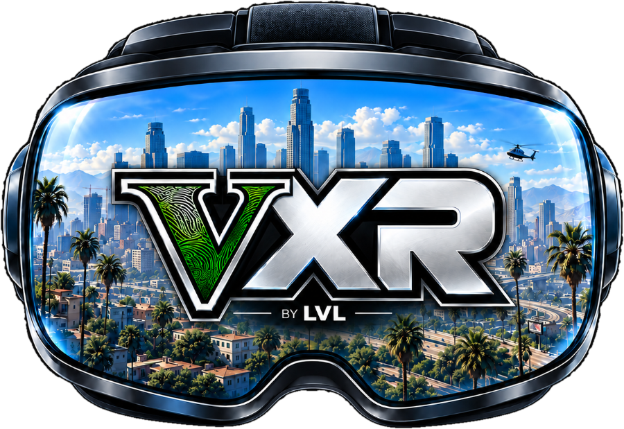

  

# GTAVXR by LVL 1.0

Explore the open world of GTA V Legacy in VR through Story Mode, with stereoscopic rendering, head tracking, and motion controllers.

[Tester quick start and Quest 3 controls](docs/TESTER_QUICKSTART.md)

## Before you play

- **Start at Franklin and Lamar.** For your first VR session, load a save from after the North Yankton prologue. If you start a new game, you can complete North Yankton with VR off and press **F10** to turn it back on when you reach Franklin and Lamar. [First session](docs/FIRST_SESSION.md)
- **Recenter whenever the camera is out of place.** Face forward in your usual playing posture and select **VR Menu → Recenter**. Do this first if your position or body pose is off as well. [How to recenter](docs/TROUBLESHOOTING.md#recenter-the-view)
- **Adjust the experience to your preferences.** To change the position, size, or visibility of HUD elements, open **VR Menu → Settings → HUD and interfaces**. The same **Settings** menu lets you adjust turning, button bindings, vibration, body view, and hand and weapon calibration. [VR menu settings](docs/VR_MENU.md#vr-settings)
- **Learn the basic gestures.** Reach over your shoulder and hold the side grip button to open the weapon wheel. To pick up an object, bring an empty hand close to it and hold that hand's grip button. [Weapon wheel](docs/VR_CONTROLS.md#weapon-wheel-and-holsters) · [Physical interaction](docs/VR_CONTROLS.md#physical-interaction)
- **Keep F10 handy.** With the GTA window focused, **F10** switches between VR and flatscreen. You can finish a mission step with a keyboard and mouse or a standard gamepad, then switch back to VR. [VR controls](docs/VR_CONTROLS.md)

## Story Mode in VR

GTAVXR 1.0 focuses on exploring the open world in VR. Story missions are playable, though some sequences may need an adjustment or a temporary switch to standard controls. Camera transitions controlled by the game can change your perspective abruptly or leave the view out of place when you regain control.

Cutscenes retain their original framing to preserve how each scene is presented. If a cutscene makes you feel motion sick, skip it when the game offers that option. If the camera is out of place when you return to gameplay, choose **VR Menu → Recenter**.

The first switch from Michael to Trevor in **North Yankton** can fail with motion controllers. When the guard grabs Michael, press **F10**, switch to Trevor with **Left Alt and the mouse** or a standard gamepad, then press **F10** again when you want to return to VR. [Starting a new game](docs/FIRST_SESSION.md#starting-a-new-game)

## Known issues

| If this happens | What to do |
| --- | --- |
| The camera is out of place, under the map, or looking at the ocean after a mission | Select **VR Menu → Recenter**. |
| A cutscene makes you feel disoriented or motion sick | Skip it when the game offers that option. |
| Switching to Trevor or completing a mission step fails with motion controllers | Press **F10** and continue with a keyboard and mouse or a standard gamepad. Press **F10** again to return to VR. |
| The steering wheel stops following your hands | Release the grip button and grab the wheel again. |
| The Suite shows **Access is denied** during installation | Run **GTAVXR.exe** as administrator. If the recovery notice appears, select **Fix now**. |
| GTA remains running after you quit from the pause menu | Save your progress and select **Force GTA to close** in the Suite. |

[Known issues and workarounds](docs/KNOWN_ISSUES.md)

## Install and play

1. Prepare a legal copy of GTA V Legacy, 64-bit Windows, and a headset connected to your PC through a compatible OpenXR runtime.
2. Download **GTAVXR.exe** from Releases. Right-click it and select **Run as administrator**. Select your GTA V Legacy folder, click **Continue**, then click **Install GTAVXR**. The Suite checks your game files and applies the included binary patch on your PC.
3. Choose whether to copy your existing saves or start a new story.
4. Open **Settings → Headset** and select the runtime for your connection. Click **Play** to enter Story Mode. Press **F10** if the game opens in flatscreen.
5. Save your progress and select **Force GTA to close** in the Suite when you finish. Wait for the Suite to finish closing the session before playing again.

## Guides

| To learn how to… | See |
| --- | --- |
| Install, update, repair, or uninstall | [Installation](docs/INSTALLATION.md) |
| Set up the headset, profiles, saves, and Suite options | [Suite and profiles](docs/SUITE.md) · [Profiles and saves](docs/SAVES.md) |
| Move, drive, fly, or use weapons in VR | [VR controls](docs/VR_CONTROLS.md) |
| Use the Trainer or adjust movement, calibration, and the HUD | [VR menu and Trainer](docs/VR_MENU.md) |
| Use holsters, dual-wield, or pick up objects | [Using either hand and dual-wielding](docs/VR_CONTROLS.md#using-either-hand-and-dual-wielding) · [Physical interaction](docs/VR_CONTROLS.md#physical-interaction) |
| Enable MVGA, Open World Interiors, content packs, or scripts | [Mods](docs/MODS.md) |
| Set up DLSS, Neural Rendering, or OFXR | [Graphics](docs/GRAPHICS.md) |
| Get past the prologue and close the session | [First session and closing the game](docs/FIRST_SESSION.md) |
| Check compatibility or diagnose a problem | [Known issues](docs/KNOWN_ISSUES.md) · [Compatibility](docs/COMPATIBILITY.md) · [Troubleshooting](docs/TROUBLESHOOTING.md) |

[Changelog](CHANGELOG.md) · [Public source components](docs/SOURCE_CODE.md) · [Third-party notices](THIRD_PARTY_NOTICES.md)
