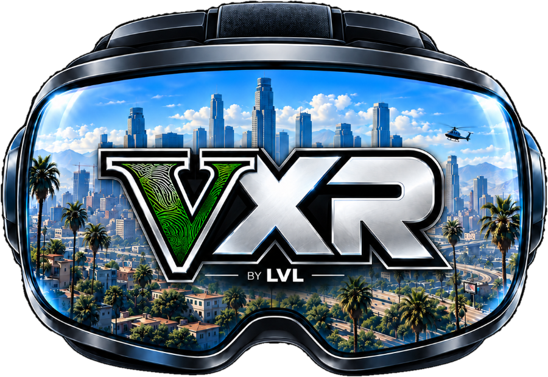

  

# GTAVXR by LVL

Play GTA V Legacy Story Mode in VR with native stereoscopic rendering, six-degree-of-freedom tracking, motion controls, full-body IK, physical interaction, and cockpit controls.

[Download GTAVXR](https://github.com/LVL-VR/GTAVXR/releases/latest) · [Install, update or remove](docs/INSTALLATION.md) · [VR controls](docs/VR_CONTROLS.md)

## Start here

- **First installation.** Use the GTA V Legacy folder containing **GTA5.exe**. Install from the Suite, select the OpenXR runtime for your connection, and choose a Story save. For your first VR session, start at **Franklin and Lamar** or later. [Installation](docs/INSTALLATION.md) · [First session](docs/FIRST_SESSION.md)
- **Updating.** Open the new launcher with your existing Suite library and use **Update GTAVXR**. Your profile, saves and settings are available from that library. [Update and keep your data](docs/INSTALLATION.md#update-and-keep-your-data)
- **Open the VR menu.** With SteamVR, center both sticks, click **L3 + R3** and release both. **F9** is the default keyboard shortcut for SteamVR. With other runtimes, use **Menu** on the left controller. [Menu controls](docs/VR_CONTROLS.md#open-the-vr-menu-and-recenter)
- **Story Mode workarounds.** With the GTA window focused, **F10** switches between VR and flatscreen. Use it for a mission step that needs standard controls, including the first switch to Trevor in North Yankton. The first-session guide walks through that step and explains how to close the game from the Suite. [First session](docs/FIRST_SESSION.md)

## Guides

| What you want to do | Guide |
| --- | --- |
| Choose a headset runtime and check tested setups | [Compatibility](docs/COMPATIBILITY.md) |
| Set up the Suite, manage profiles and select a save | [Suite](docs/SUITE.md) · [Profiles and saves](docs/SAVES.md) |
| Move, drive, fly, use weapons or remap controls | [VR controls](docs/VR_CONTROLS.md) |
| Change cutscene camera, place subtitles, adjust calibration or use the Trainer | [VR menu and Trainer](docs/VR_MENU.md) |
| Import, configure or troubleshoot mods and scripts | [Mods](docs/MODS.md) |
| Configure DLSS, Neural Rendering or OFXR | [Graphics](docs/GRAPHICS.md) |
| Work around a known issue or report a problem | [Known issues](docs/KNOWN_ISSUES.md) · [Troubleshooting](docs/TROUBLESHOOTING.md) |

[Changelog](CHANGELOG.md) · [Public source components](docs/SOURCE_CODE.md) · [Third-party notices](THIRD_PARTY_NOTICES.md)
